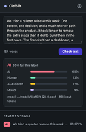
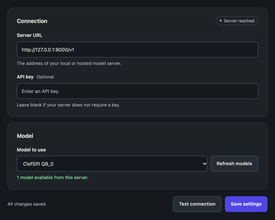

# ClefSift

ClefSift pairs a Chrome extension with a fine-tuned [Clef 27B](https://huggingface.co/Cloudflare/clef) decision model.
It classifies text as human, AI-assisted, mixed, or AI-generated.

The extension checks selected text, pages, and pasted text.
Optional LinkedIn scanning adds feed badges and can dim AI or AI-assisted posts.

**Results indicate writing patterns. They do not prove authorship.**
Independent professional-post accuracy remains untested.

| LinkedIn feed | Text check | Local model |
|:---:|:---:|:---:|
| [](assets/screenshots/feed.png) | [](assets/screenshots/text-check.png) | [](assets/screenshots/settings.png) |

Demonstration screens use fictional profiles. Example verdicts do not establish accuracy.

## Use the extension

1. Clone this repo:

   ```bash
   git clone https://github.com/spmurrayzzz/clefsift.git
   cd clefsift
   ```

2. Open `chrome://extensions` and enable **Developer mode**.
3. Select **Load unpacked**, then select `extension/`.
4. Open ClefSift settings and enter your server URL, such as `http://127.0.0.1:8000/v1`.
5. Select **Connect server** and approve origin access.
6. Select the server model, save the settings, then select **Test connection**.

The server must support `POST /v1/systemone`. A chat-completions API alone does not meet this requirement.
The API key is optional when the server permits requests without a key.

Model card and weights: [spmurrayzzz/clefsift on Hugging Face](https://huggingface.co/spmurrayzzz/clefsift).
The weight upload is in progress. Check the model repo for download status.
Follow the [local serving guide](docs/serving.md) after the files arrive.
Weights stay outside Git. You can also use an existing compatible server.

To try the interface without a model, run:

```bash
python3 tools/mock_server.py
```

Use `http://localhost:8787/v1`, key `test-key`, and model `mock-clef`.
The mock returns synthetic results. It does not detect AI text.

`tools/corpus` controls generation from one JSON config. Use `start`, `status`, and `stop` with `--config /path/to/corpus.json`; the default is `./corpus.json`. Stop returns immediately, or use `stop --wait`. The config alone sets models and worker counts. No approval file, code-hash update, or training environment is required. See [corpus operation](docs/general-corpus.md#start-stop-and-status).

The public dataset is [spmurrayzzz/clefsift-cleaned](https://huggingface.co/datasets/spmurrayzzz/clefsift-cleaned): 90,784 `{text, label}` rows in train, validation, then holdout order. Supply its original split boundaries at runtime with `--split-rows`; keep the existing holdout out of training and validation. The trainer does not assume row counts from a dataset name.

## Train your model

Use a CUDA machine with [uv](https://docs.astral.sh/uv/getting-started/installation/) installed. Pass your chosen paths directly to the commands below. No environment variables or YAML edits are needed.

### 1. Clone and install

```bash
git clone https://github.com/spmurrayzzz/clefsift.git
cd clefsift
uv sync --locked --extra train
```

### 2. Download the dataset to your target path

```bash
uv run --no-sync hf download spmurrayzzz/clefsift-cleaned clefsift-cleaned.jsonl \
  --repo-type dataset --revision 1f891d864e5759fc15f6706a41a16285a92d259f \
  --local-dir /path/to/dataset
```

The command creates the target directory. Replace `/path/to/dataset` with your chosen location.

### 3. Train with your checkpoint, dataset, and output paths

Use a complete local Clef reference checkpoint. See [checkpoint download](docs/training.md#reference-checkpoint) if you need one.

For the dataset downloaded above, copy the split values as shown. They preserve its existing splits; you do not need to count rows.

```bash
uv run --no-sync tools/clefsift train \
  --model /path/to/clef \
  --data /path/to/dataset/clefsift-cleaned.jsonl \
  --output-dir /path/to/output \
  --split-rows 73896 8424 8464
```

`--model` selects the reference checkpoint directory. `--data` selects the training dataset. `--output-dir` selects where the run writes prepared data, checkpoints, reports, and the exported model. These paths can use different disks.

The existing test holdout stays out of training and validation. For your own unsplit dataset, see [fraction-based splits](docs/training.md#choose-splits-at-runtime).

The finished fine-tuned model is `/path/to/output/<timestamp>-<id>/release/`. Export is automatic, and the command prints the full destination as `Release:`.

Use an available GPU and keep at least 30 GiB free beyond checkpoint and export space. The default recipe runs one epoch with a 720-minute total limit. Training and export do not start or replace a serving process.

The new [general corpus workflow](docs/general-corpus.md) starts from human-only sources, generates through Pi, and keeps validation and final holdout separate.
Every configured model generates remaining examples from a shared queue. Actual model contributions depend on throughput. The controller retries transient failures within the existing two-attempt limit; provider failures disable only that route. Each launch executes a source snapshot and preserves completed outputs and the original deadline. Generation does not automatically assemble data, start training, or access final-holdout text. Preparation and assembly interfaces remain separate in this first cleanup.
[Export and serving](docs/serving.md) covers GGUF conversion and Q8 comparison.

The tools preserve source groups and explicit splits.
They measure complete requests, reject truncation, and select checkpoints before held-out scoring.
Generation and training require explicit resource limits.

This release contains code, configuration, and text-free source locators.
It excludes corpus text, generated examples, checkpoints, and weights.
The process is repeatable, but different generators and environments can change the results.

## Results

The selected v2 reference scored 169/188 on matched validation and 162/188 on a held-out Luna version.
Its Q8 export retained 525/526 class predictions across three validation panels.
These panels share source groups and controls. They are not independent benchmarks.

See [results and limits](docs/results.md) before you interpret these figures.

## Repo

| Path | Contents |
|---|---|
| `extension/` | Manifest V3 extension, with no dependencies or build step |
| `finetune/` | Preparation, generation, training, and evaluation tools |
| `tools/clefsift` | Single entry point: `init`, `corpus`, `train`, `export`, `evaluate`, `demo` |
| `tools/mock_server.py` | Local interface demonstration |
| `docs/` | [Extension and privacy](docs/extension.md), [training](docs/training.md), [serving](docs/serving.md), [results](docs/results.md) |

## License

[Apache-2.0](LICENSE). Copyright 2026 spmurrayzzz.

Training uses [Unsloth](https://unsloth.ai/docs/basics/train-your-own-decision-model-with-unsloth) and Cloudflare Clef.
Dependencies retain their own licenses. This project is not affiliated with Cloudflare or Unsloth.
Dataset license declarations do not establish rights in each source text.
